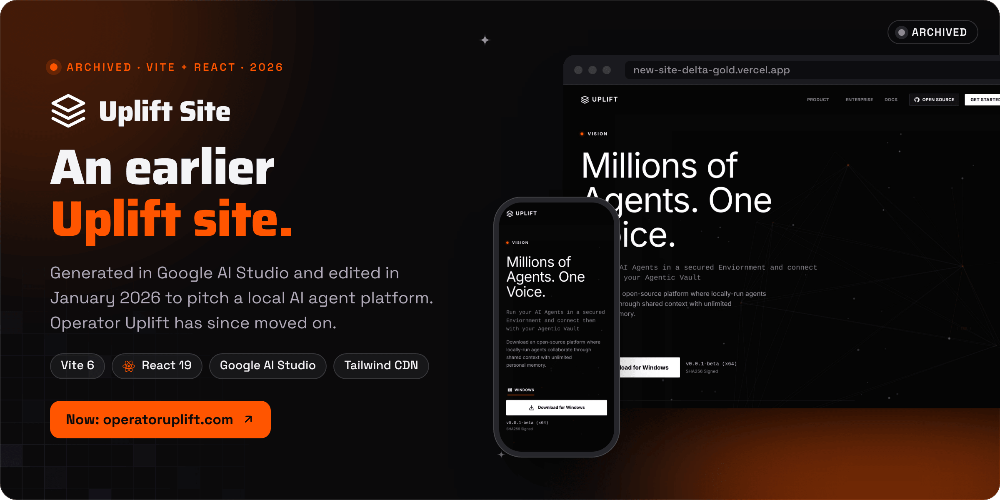
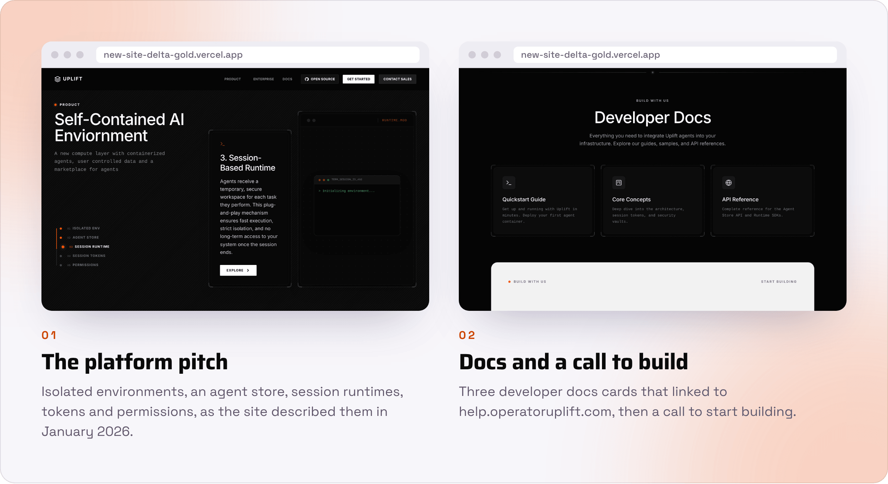

<div align="center">



<br><br>

<a href="https://operatoruplift.com"></a>&nbsp;&nbsp;
<a href="#run-it-locally"></a>

<br><br>


<a href="https://new-site-delta-gold.vercel.app"></a>


<h3>An archived landing page from Operator Uplift's agent-platform phase.</h3>

<b>2 Dec 2025</b> AI Studio starter &nbsp;→&nbsp; <b>16 Jan 2026</b> Operator Uplift edits &nbsp;→&nbsp; <b>Archived</b>

<br>

<a href="#what-it-was">What it was</a> &nbsp;·&nbsp;
<a href="#status">Status</a> &nbsp;·&nbsp;
<a href="#run-it-locally">Run it locally</a>

</div>

<br>

<picture>
  <source media="(prefers-color-scheme: dark)" srcset="docs/readme/screens-dark.png">
  
</picture>

<p align="center"><sub>Captured from a local build on 30 October 2026. Tailwind was compiled locally from the page's own config, because its CDN is unreachable from where these were captured.</sub></p>

**This repository is archived.** It holds Uplift Site, a single-page marketing site that Operator Uplift edited in January 2026 to pitch UPLIFT, a local AI agent platform. It began as a Google AI Studio app, described in `metadata.json` as a recreation of the Factory website hero, with a starter commit on 2 December 2025. Operator Uplift's commits on 16 January 2026 changed the headline, the contact details and the docs links, which point to help.operatoruplift.com.

<br>

## What it was

The copy is a record of that pitch, not a description of anything Operator Uplift offers now. It claimed "Millions of Agents. One Voice.", an "open-source platform where locally-run agents collaborate through shared context with unlimited personal memory", isolated sandboxes, an agent store and local-first security. The Windows download button (v0.0.1-beta) linked to `#`, and a "Powered By" strip listed eight third-party models by name.

No later repository is named in this one's history. Operator Uplift today is commitment infrastructure at [operatoruplift.com](https://operatoruplift.com): one small daily action, proved with a photo, and an AI Game Master decides whether the day counts. That site is built from the private WEBSITE repo.

<br>

## Status

<table>
  <tr valign="top">
    <td width="16%" align="center"></td>
    <td>Read-only on GitHub; the last commit is from 16 January 2026. The repository lists <code>new-site-delta-gold.vercel.app</code> as its homepage, and whether that deployment still serves this code was not checked.</td>
    <td width="22%"><a href="https://operatoruplift.com">Operator Uplift today</a></td>
  </tr>
</table>

<br>

## Run it locally

The site still installs and builds (checked on 30 October 2026 with Node 22).

```bash
npm ci          # 68 packages from package-lock.json
npm run dev     # http://localhost:3000, as set in vite.config.ts
npm run build   # static build in dist/
```

- **No API key is needed.** `vite.config.ts` maps `GEMINI_API_KEY` into the bundle, but no code reads it, so the old step of putting a Gemini key in `.env.local` does nothing.
- **It needs a network connection to look right.** `index.html` loads Tailwind from `cdn.tailwindcss.com` and fonts from `fonts.cdnfonts.com` at runtime.
- `index.html` also links `/index.css`, which does not exist. Vite warns during the build and the browser gets a 404, with no effect on the page.

The project was generated in Google AI Studio; [the AI Studio project](https://ai.studio/apps/drive/1hD981Ccyw3-xOd-IRIJV-reIwC8SdPdd) opens only for accounts with access to it.

<details>
<summary><b>Repository layout</b></summary>
<br>

| Path | Contents |
|---|---|
| `App.tsx`, `index.tsx` | Page state (home, product, contact, terms, privacy) and the React entry point |
| `sections/` | Hero, Product, Security, DeveloperDocs, BuildWithUs, Contact, Terms, Privacy and ProductPage |
| `components/` | Navbar, Footer, hero animation, network visual, download widget, the "Powered By" strip and icons |
| `services/dataService.ts` | The hero copy and download options, returned from a local mock after 100 ms |
| `index.html` | The Tailwind CDN config, global styles and the import map AI Studio added |
| `metadata.json` | The AI Studio app name and description |

</details>

<br>

<p align="center"><sub>This repository has no license file.</sub></p>

<p align="center"><sub>From <a href="https://rvaclassic.xyz">Matt Sim</a>, founder of <a href="https://operatoruplift.com">Operator Uplift</a>. More builds at <a href="https://github.com/operatoruplift">github.com/operatoruplift</a>. Want one built for your product? <a href="https://cal.com/rvaclassic/15min">Book a 15-minute call</a>.</sub></p>
